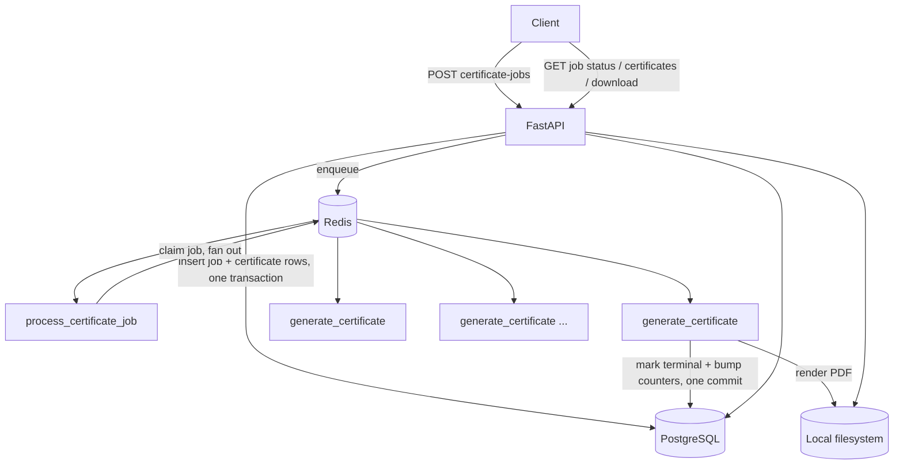

# Bulk Certificate Generator — Backend

A backend service that accepts a bulk list of certificate recipients,
generates one PDF certificate per recipient in the background, tracks
per-recipient and overall progress, and lets clients retrieve the results —
without one bad recipient ever blocking the rest of the batch.

## Tech stack

- **Python 3.12**, **FastAPI** — async-capable web framework with free request
  validation and OpenAPI docs from the same Pydantic models used everywhere else.
- **PostgreSQL** + **SQLAlchemy 2.x** (sync) + **psycopg3** — relational
  integrity (foreign keys, a unique constraint on certificate numbers) and
  atomic, race-safe counter updates (see [Concurrency](#concurrency--race-conditions) below).
- **Alembic** — versioned schema migrations.
- **Pydantic v2** / **pydantic-settings** — request validation and
  environment-driven configuration.
- **Celery** + **Redis** — background processing, decoupled from the HTTP
  request/response cycle.
- **ReportLab** — PDF rendering.
- **Docker Compose** — four services (`api`, `worker`, `postgres`, `redis`)
  runnable with one command.
- **Pytest** — 64 tests across unit / API / integration layers.

## Architecture



One HTTP request creates the job and every certificate row, then enqueues a
single orchestrator task and returns `202` immediately. The orchestrator
claims the job and dispatches one independent task per certificate; a
worker crash or a broken template for one recipient never stops the rest.

## Project structure

```
app/
  main.py                   FastAPI app: CORS, routers, exception handlers
  core/
    config.py                Settings (env-driven, pydantic-settings)
    enums.py                 JobStatus / CertificateStatus
    exceptions.py             Typed errors + handlers -> consistent error envelope
    logging.py                logging setup
  db/
    base.py / session.py / models.py   SQLAlchemy Base, engine/session, ORM models
  schemas/                    Pydantic request/response models + validation rules
  api/routes/                 HTTP layer only — no business logic
  repositories/                Atomic DB operations (claim/bump/finalize)
  services/                    job_service, certificate_service,
                                certificate_generator (pure PDF rendering),
                                storage_service (StorageService/LocalStorageService)
  templates/                   ReportLab drawing code, no DB/HTTP/Celery knowledge
  workers/                     celery_app, tasks (process_certificate_job, generate_certificate)
  utils/                       certificate ID generation
alembic/                      Migration environment + initial schema migration
tests/
  unit/                        Pure logic, no DB/HTTP/Celery
  api/                         HTTP contract only, Celery dispatch mocked
  integration/                 Real Postgres + real (eager) Celery pipeline
docker-compose.yml             api, worker, postgres, redis
Dockerfile
.env.example
```

**Deviation from a conventional layered template, explained:** enums live in
`core/enums.py` rather than inside `db/models.py`, specifically so both the
ORM layer and the Pydantic schemas can import them without either layer
depending on the other.

## Database schema

**`generation_jobs`** — one row per bulk request.
`id`, `status`, `total_count`, `successful_count`, `failed_count`,
`created_at`, `started_at`, `completed_at`, `error_summary`.

**`certificate_records`** — one row per recipient, FK to `generation_jobs`
with `ON DELETE CASCADE`.
`id`, `job_id`, `recipient_name`, `recipient_email`, `certificate_title`,
`course_name`, `issue_date`, `certificate_number` (unique), `status`,
`storage_key`, `error_message`, `created_at`, `completed_at`.

Why two tables instead of one: a job and a certificate have different
lifecycles and different cardinality (one job → many certificates), and
every certificate needs to carry its own independent status/error/storage
key so one recipient's outcome never has to be inferred from or entangled
with another's. Template fields (`certificate_title`, `course_name`,
`issue_date`) are **denormalized onto every certificate row** at creation
time, so a worker never needs to join back to `generation_jobs` to know what
to render — each certificate is fully self-contained.

Indexes: `certificate_records(job_id)`, `certificate_records(job_id, status)`
(used by the paginated/filtered certificate listing), and a unique index on
`certificate_number`.

## API documentation

All endpoints return a consistent error envelope on failure:
```json
{"error": {"code": "VALIDATION_ERROR", "message": "...", "details": [...]}}
```

### `POST /api/v1/certificate-jobs` → 202

```json
{
  "certificate_title": "Certificate of Completion",
  "course_name": "Advanced Python Programming",
  "issue_date": "2026-01-15",
  "recipients": [
    {"name": "Jane Doe", "email": "jane@example.com"},
    {"name": "John Smith", "email": "john@example.com"}
  ]
}
```
```json
{
  "job_id": "3f2b6e2a-...-e9",
  "status": "PENDING",
  "total_count": 2,
  "successful_count": 0,
  "failed_count": 0,
  "created_at": "2026-01-15T10:00:00Z"
}
```
`422` on: empty `recipients`, more than `MAX_BULK_SIZE` recipients, blank
name, malformed email, unparsable date, or a duplicate `(name, email)` pair
within the same request.

### `GET /api/v1/certificate-jobs/{job_id}` → 200
```json
{
  "job_id": "3f2b6e2a-...-e9",
  "status": "COMPLETED_WITH_ERRORS",
  "total_count": 50, "successful_count": 47, "failed_count": 2, "pending_count": 1,
  "created_at": "...", "started_at": "...", "completed_at": null,
  "error_summary": null
}
```
`404` if the job doesn't exist.

### `GET /api/v1/certificate-jobs/{job_id}/certificates?status=&page=&page_size=` → 200
```json
{
  "job_id": "3f2b6e2a-...-e9", "page": 1, "page_size": 50, "total": 50,
  "items": [{
    "certificate_id": "a1c4...", "recipient_name": "Jane Doe",
    "recipient_email": "jane@example.com", "status": "COMPLETED",
    "certificate_number": "CERT-2026-A1B2C3D4",
    "download_url": "/api/v1/certificates/a1c4.../download",
    "error_message": null, "created_at": "...", "completed_at": "..."
  }]
}
```

### `GET /api/v1/certificates/{certificate_id}/download`
- `COMPLETED` → `200`, `application/pdf`
- `PENDING` / `PROCESSING` / `FAILED` → `409`, body includes `context.status`
  (and `context.error_message` when failed)
- unknown id → `404`

## Job lifecycle

```
PENDING → PROCESSING → COMPLETED              (every certificate succeeded)
                      → COMPLETED_WITH_ERRORS  (mixed outcomes)
                      → FAILED                 (every certificate failed, OR
                                                 the job itself could not be
                                                 scheduled — see below)
```
Certificates: `PENDING → PROCESSING → COMPLETED | FAILED`. No automatic
retry on a generation failure — explained in [Failure handling](#failure-handling--background-processing).

## Failure handling & background processing

`POST /api/v1/certificate-jobs` enqueues one orchestrator task
(`process_certificate_job`) and returns immediately. That task claims the
job (`PENDING → PROCESSING`, atomically — a duplicate dispatch just no-ops)
and fans out one `generate_certificate` task per recipient. Each certificate
task claims its own row the same way, generates independently, and in a
**single commit** marks itself terminal and bumps the job's
`successful_count`/`failed_count` — pairing those two writes in one commit
guarantees a crash can never leave the counters out of sync with the
certificates. The job's final status is decided by a guarded
`UPDATE ... WHERE status = 'PROCESSING'`, so whichever task finishes last is
the only one that can flip it — correct under concurrent workers with no
explicit locking.

A certificate failing never stops the others: each `generate_certificate`
task catches its own `CertificateGenerationError`, records it against that
certificate, and returns — the remaining tasks were already dispatched
independently of it. There's no automatic retry on a generation failure: the
storage key is deterministic (`{certificate_number}.pdf`), so a retry
wouldn't create a duplicate file, but a broken template or malformed
recipient data fails the same way every time, and retrying would only delay
marking it `FAILED`. Celery's `task_acks_late` + `task_reject_on_worker_lost`
do provide redelivery if a *worker process itself* dies mid-task, and that's
safe only because every task claims its row before doing any real work —
proven in `tests/integration/test_idempotency.py` by actually re-invoking
the task functions, not just asserting on the claim guard in isolation.

If the job itself can't even be scheduled (e.g. Redis is unreachable right
after the job and its certificates were committed), the job is marked
`FAILED` with `error_summary` set, rather than the client getting a bare
500 for a job that, in fact, already exists in the database.

**Known limitation:** if a worker crashes between claiming a row and
finishing it, that row stays `PROCESSING` forever — there's no
reconciliation job in this version. Noted here deliberately rather than
left for someone else to discover.

## Security

- **Path/ID safety:** certificate storage keys are always server-generated
  (`{certificate_number}.pdf`, from a UUID-derived number) — never built
  from client input. `LocalStorageService` still re-validates every key with
  `resolve()` + `is_relative_to(root)` before touching disk, as defense in
  depth.
- **Bulk-size limit** (`MAX_BULK_SIZE`, default 500) rejects oversized
  requests before any DB work happens.
- **No stack traces leaked:** a catch-all exception handler logs the full
  traceback server-side and returns a generic `INTERNAL_ERROR` body.
- **CORS** is environment-driven (`CORS_ORIGINS`), not hardcoded.
- **No secrets in the repo:** `.env` is gitignored; `.env.example` ships only
  placeholder local-dev credentials.
- **No authentication** on this API by design scope — see
  [What I'd change for production](#what-id-change-for-production).

## Local setup

```bash
cp .env.example .env
docker compose up --build -d
docker compose exec api alembic upgrade head
curl http://localhost:8000/health
```
Expected: `{"status":"ok","database":"ok"}`.

### Running outside Docker

```bash
python -m venv .venv && .venv\Scripts\activate   # Windows
pip install -r requirements.txt
# In .env, change DATABASE_URL / REDIS_URL hosts from "postgres"/"redis" to "localhost"
alembic upgrade head
uvicorn app.main:app --reload
celery -A app.workers.celery_app worker --loglevel=info   # separate terminal
```

## Environment variables

| Variable | Purpose | Default |
|---|---|---|
| `DATABASE_URL` | SQLAlchemy connection string | — (required) |
| `REDIS_URL` | Default broker/backend if the two below are unset | `redis://redis:6379/0` |
| `CELERY_BROKER_URL` / `CELERY_RESULT_BACKEND` | Celery broker/result backend | — |
| `MAX_BULK_SIZE` | Max recipients per job request | `500` |
| `CORS_ORIGINS` | Comma-separated allowed origins, or `*` | `*` |
| `STORAGE_DIR` | Local filesystem root for generated PDFs | `storage` |
| `LOG_LEVEL` | Python logging level | `INFO` |
| `POSTGRES_USER` / `POSTGRES_PASSWORD` / `POSTGRES_DB` | Read by the Postgres container itself | — |

## Docker

Four services: `postgres`, `redis`, `api`, `worker` — the `worker` service
runs `celery -A app.workers.celery_app worker` from the same image as `api`.
Both `api` and `worker` wait on Postgres/Redis healthchecks before starting.

## Database migrations

`alembic/versions/0001_initial.py` creates both tables, the two Postgres
enum types (`job_status`, `certificate_status`), and every index described
above.
```bash
docker compose exec api alembic upgrade head    # apply
docker compose exec api alembic downgrade base  # revert, if needed
```

## Running tests

```bash
pip install -r requirements-dev.txt
pytest                              # all 64 tests (needs Postgres + Redis reachable)
pytest tests/unit                   # 16 tests, no DB/broker needed at all
pytest tests/api                    # HTTP contract, Celery dispatch mocked
pytest tests/integration            # real Postgres + real (eager) Celery pipeline
pytest --cov=app --cov-report=term-missing   # coverage report
```
`tests/conftest.py` auto-creates a disposable `certificates_test` database on
first run and runs Celery in eager (synchronous, in-process) mode — no
broker needed for the test suite itself.

## Example certificate retrieval

```bash
JOB_ID=$(curl -s -X POST localhost:8000/api/v1/certificate-jobs \
  -H "Content-Type: application/json" \
  -d '{"certificate_title":"Certificate of Completion","course_name":"Advanced Python Programming","issue_date":"2026-01-15","recipients":[{"name":"Jane Doe","email":"jane@example.com"}]}' \
  | python -c "import sys,json; print(json.load(sys.stdin)['job_id'])")

curl localhost:8000/api/v1/certificate-jobs/$JOB_ID           # poll until COMPLETED
curl localhost:8000/api/v1/certificate-jobs/$JOB_ID/certificates
curl -OJ localhost:8000/api/v1/certificates/<certificate_id>/download
```

## Design decisions & trade-offs

- **Sync SQLAlchemy, not async.** The Celery worker is sync regardless;
  mixing an async DB driver into the API side for no real throughput benefit
  at this scale would just add a second driver story.
- **Fan-out per certificate, not a loop inside one task** — this is what
  makes "one failure can't stop the rest" true at the infrastructure level,
  not just a `try/except` in a loop, and it lets multiple workers process
  one bulk job in parallel.
- **No per-certificate auto-retry** — see [Failure handling](#failure-handling--background-processing).
- **Storage abstracted behind `StorageService`** so local disk can become S3
  later without touching any route or worker code (see below).

## What I'd change for production

- Authentication/authorization (API keys or OAuth) — out of scope here by
  design, not an oversight.
- A reconciliation job for certificates stuck `PROCESSING` after a worker
  crash (the one known gap above).
- S3-backed storage instead of local disk (see next section).
- Structured (JSON) logging + request IDs for correlating a request across
  the API and worker logs.
- Rate limiting on job creation.

## Future improvements

- Swap `LocalStorageService` for an S3 implementation of the same
  `StorageService` interface — `save`/`get`/`exists` already don't leak any
  "local path" assumption into callers.
- A periodic sweep that re-dispatches certificates stuck `PROCESSING` past
  some timeout.
- Per-certificate retry with backoff for genuinely transient failures (not
  implemented now, since nothing in the current pipeline is transient —
  there's no network call inside `generate_certificate` yet).

---

### How would I migrate storage to S3?

Write an `S3StorageService(StorageService)` implementing the same three
methods (`save`, `get`, `exists`) against `boto3`, swap what `get_storage()`
(API) and the worker's `LocalStorageService(...)` construction instantiate,
and add the AWS credentials/bucket name to settings. No route, service, or
task code changes, because none of them know what "local" means — they only
call the interface.

### How would this scale to 100,000 certificates?

The fan-out architecture already parallelizes across however many workers
you run — `docker compose up --scale worker=8`. The real bottleneck at that
volume is a single Postgres primary absorbing `total_count` individual
UPDATE statements for counters; the atomic-UPDATE design (never a Python
read-modify-write) is what keeps that correct under load, and `task_acks_late`
plus the idempotent claim guard mean a burst of worker restarts under load
doesn't corrupt anything, just re-queues cleanly. Past that, the next step
would be batching certificate generation (e.g. N recipients per task instead
of 1) to cut Celery message overhead, and moving storage to S3 so disk I/O
isn't shared across worker replicas.
